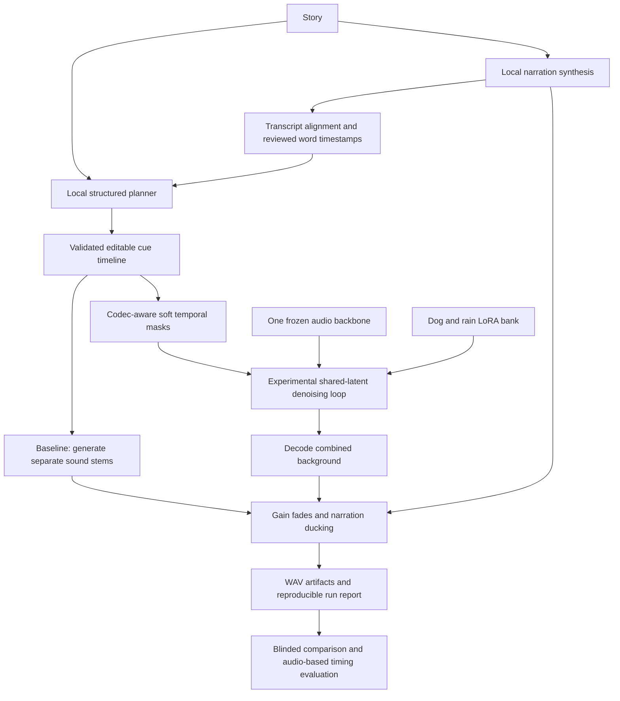

# C-MoLo: architecture and research proposal

Implementation status update, 26 October: this document preserves the initial design.
Base inference now runs on the V100; category LoRA training code is available for a smoke
test. See LORA_PILOT.md for current scope and validation limits.

Prepared 19 October 2026. Review: 28 October 2026. GPU access starts 22 October,
approximately 48 GB VRAM; exact GPU, access hours and software environment remain to be confirmed.

## Research question

Can category-specific low-rank adapters with temporal prediction composition improve
event fidelity and overlap coverage over a general audio generator and a controlled
stem-mixing baseline, while preserving temporal accuracy and narration intelligibility?

C-MoLo is our working project name, not an established method or a claim of novelty.
The proposed contribution is the experimentally evaluated combination of audio category
adaptation, speech-grounded masks, and overlapping-event composition. Literature review
must establish what is new before any paper claims are made.

## What the senior's paper actually contributes

BackgroundMellow (Jamulkar and Hazra, supplied PDF, July 2026) describes:

- A master/specialist planner, SFX and environmental generators including Tango2,
  music generation/retrieval, and Parler-TTS narration (sections 3.1-3.4).
- Initial word-rate timing estimates, then Whisper word timestamps (sections 3.1, 4.1).
- A LLaMA timing predictor, DSPred, fine-tuned with LoRA, and hybrid alignment (4.3-4.4).
- Waveform superimposition, narration ducking, and fades (4.5).
- Approximately 100 trailers / 1,000 clips, and a 40-prompt ablation evaluation (4.2, 6.1).

Thus replacing a remote API with local inference is an engineering contribution;
sound-generation LoRAs and compositional denoising are the research extension.
DSPred's existing LoRA adapts a language model for timing, not the audio denoiser.
We retain the useful narration clock and compare against stem mixing fairly.
This prototype is not a reproduction of the senior's full system or reported scores.

## Corrections to the supplied pitch

| Pitch | Defensible position |
|---|---|
| Specialist training always sounds better | Hypothesis; small datasets can overfit or reduce diversity. |
| Latent fusion prevents phase cancellation | Not guaranteed. Correlated opposing waveforms can cancel; masking, loudness and clipping are different problems. |
| Averaging dog and piano predictions produces both | Not guaranteed. A compromise, suppression or leakage is possible. |
| Each expert operates only on its assigned time slice | Its output is masked; global attention and codec receptive fields can still leak across boundaries. |
| LoRA takes a few hours on Colab | Measure memory, steps/second, data throughput and validation convergence first. |
| 200 videos is sufficient | Count usable, licensed, varied clips and independent sources, not just videos. |
| AudioLDM training repo provides ready-made LoRA | Its README documents training/fine-tuning; we did not verify a supported LoRA recipe. |
| Mechanism is completely unique | Composable Diffusion and MultiDiffusion are relevant prior work; audio novelty remains unestablished. |

## Proposed system

Narration stays separate in the first study. This avoids making background composition
responsible for exact speech, supports intelligibility measurement, and keeps final voice
level adjustable. A fused background cannot expose authentic independent stems after the
fact; preserve the baseline stems and label this limitation in the future UI.

### Component boundaries

| Component | Contract | Initial choice / status |
|---|---|---|
| Planner | story + aligned words -> timeline v1 | Keyword draft implemented; local LLM structured planner planned |
| Narration | text -> PCM WAV + transcript | External WAV accepted now; local TTS integration planned |
| Alignment | WAV + known transcript -> words and confidence | Planned forced alignment; low-confidence words reviewed |
| Timeline | stable cue IDs, kind/category/prompt/start/end/gain/fade | Implemented validation; overlaps explicitly allowed |
| Stem generator | cue + seed -> stereo samples | Diagnostic tones, input WAVs, optional Stable Audio baseline adapter |
| Mask builder | intervals + codec frame duration + padded frame count -> K x T | Implemented numerical utility |
| Composer | shared latent + compatible expert predictions -> one scheduler update | NumPy reference loop; real torch/LoRA integration planned |
| Mixer | stems or fused background + narration -> stereo mix | Implemented stem baseline; fused background can be supplied as one stem |
| Run service | validated inputs -> immutable output folder | Implemented; reused later by a job worker |
| Evaluator | generated audio + held-out annotations -> metrics | Signal statistics now; semantic/perceptual evaluation planned |

### Backbone decision

Use Stable Audio Open 1.0 as the **initial candidate** because its public implementation
offers a latent DiT and a documented Diffusers inference interface. It supports up to
47 seconds at 44.1 kHz stereo. Start with 5-10 second scenes. This is a bounded research
choice, not a claim that it is the newest or best model. Check its model license separately
from library licenses. Do not use it as the narration model or assume long-form music quality.

On 22 October verify inference, target attention modules, scheduler parameterization,
codec stride, padded latent duration and adapter injection. Freeze the exact model revision
and package versions only after this smoke test. The repository's inference extra is a
candidate dependency range, not a GPU-tested lockfile. No model has been downloaded here.

If adaptation is not viable by 23 October, keep the same timeline/mixer and select a
backbone with a verified training path. Do not imply adapters transfer between different
backbones or noise schedules. Tango2 is relevant for comparison with the senior's system,
but that alone does not establish its suitability for the first temporal-composition implementation.

## Composition mathematics

Use k for diffusion iteration and tau for audio time. Every expert receives the **same**
latent z_k, time/noise level, codec, backbone revision and prediction parameterization.
Let p_0 be the base prediction and p_i the category-adapted conditional prediction.
Use p rather than epsilon until the backend is verified: epsilon, velocity and clean-sample
predictions cannot be interchanged without the scheduler's required conversions.

For nonnegative soft temporal masks m_i(tau) in [0,1]:

    s(tau) = sum_i m_i(tau)
    b(tau) = max(0, 1 - s(tau))
    p_fused = [b * p_0 + sum_i m_i * p_i] / max(1, s)

This convex-blend baseline keeps p_0 in uncovered regions, ramps smoothly at boundaries,
and controls scale in overlap regions. Outside masks the base remains active; this does
not guarantee silence. At full equal overlap it averages experts, which may suppress an
event. That is an experimental question, not a mathematical guarantee of source mixing.

Compare a residual-composition ablation:

    p_fused = p_0 + lambda * sum_i m_i * (p_i - p_0)

Here p_0 should use a documented common background/negative condition, and each expert
adds its category condition. This resembles compositional guidance but can amplify
instability. Record lambda and guidance; do not apply classifier-free guidance twice.
Neither expression alone establishes the correct score of a desired audio mixture.

At each iteration:

1. Scale the shared latent according to the scheduler once, with consistent inputs.
2. Evaluate base and active experts; sequential adapter switching saves weight residency.
3. Fuse compatible predictions with masks broadcast on the **latent time axis**.
4. Call scheduler.step exactly once, then proceed to the next iteration.
5. Decode the final latent once; inspect leakage and boundary artifacts in audio.

For a 1D codec, frame duration comes from codec stride / sample rate. Do not divide the
requested 10 seconds by a padded 47-second latent length. Masks in padding must be zero.
For 2D spectrogram models, identify the time axis explicitly. Short transients below the
codec's effective temporal resolution need waveform-level onset analysis.

Adapter weights are W_i = W + (alpha/r) B_i A_i with a frozen W. One resident base plus
small adapters reduces parameter/optimizer storage, but K experts still require roughly
K forward evaluations per denoising step (plus base/CFG as applicable). Sequential
evaluation is a memory strategy, not free inference. Weight-space adapter blending is
also not generally equivalent to blending the experts' nonlinear predictions.

## Training workflow

1. Curate dog and rain sources first; piano is a stretch category. Include varied
   recording environments and negative examples. Exclude unwanted speech/music bleed
   for isolated experts. Retain source URL, permission/license, attribution and provenance.
2. Group split by original source/video/recording before slicing clips; target 70/15/15
   only if source counts permit it. Check exact and near duplicates across splits.
3. Prepare 5-10 second clips at the backbone's native format. Annotate audible onset/end,
   caption, category and source. Avoid crops that remove transient onset. Estimate usable
   hours and class balance. The included audit checks IDs, WAV existence, source split
   leakage and identical file hashes; it does not verify licenses or near duplicates.
4. Cache text embeddings/codec latents with checkpoint hash and preprocessing metadata.
   If the encoder samples latents, record seed or distribution handling.
5. Freeze text encoder, codec and base denoiser. Inject LoRA into verified attention
   projections; pilot rank 8 then 16, batch 1 with accumulation, mixed precision supported
   by the GPU, gradient checkpointing if needed. These are starting experiments.
6. Match the base scheduler's noise distribution, target and loss weighting. Optimize only
   adapter weights. Use validation early stopping; do not choose a checkpoint on test data.
7. Save adapter weights plus base revision, target module names, rank/alpha, preprocessing,
   training config, data hash, seed, validation results and applicable licenses.
8. Run single-expert validation before composition. If it does not improve held-out audio,
   report that and revise data/training rather than choosing favorable demo seeds.

No trained adapters or runnable trainer are delivered in this first architecture milestone.
The actual training entry point depends on the verified backbone's internals on the GPU.

## CLI -> server -> frontend workflow

First establish stable run artifacts: timeline.json, stems/, optional narration.wav,
mix.wav, report.json and status.json. A failed run keeps status=failed. Existing run
directories are never silently overwritten. Production reproducibility additionally needs
model/adapter hashes, scheduler/guidance configuration, GPU/driver details and a package lock.

Later server: FastAPI request validation -> persistent job record -> queued single-GPU
worker -> the same Python service -> artifact store. Suggested endpoints:
POST /jobs, GET /jobs/{id}, GET /jobs/{id}/events, GET /jobs/{id}/artifacts,
POST /jobs/{id}/cancel. Use job IDs instead of arbitrary client paths; limit uploads,
validate media, authenticate requests, and never accept arbitrary model code from the UI.
Add progress, cancellation between denoising steps, failure recovery and disk quotas.
Do not run multi-minute inference inside an HTTP request or share mutable adapter state
between concurrent requests without worker isolation.

Later frontend: story entry -> narration preview -> editable event timeline -> backend and
seed selection -> job progress -> audio comparison -> export. Show timing confidence,
estimated versus aligned timing, model status and experimental labels. Expose separate
stem gain controls only for actual separate stems. No server/frontend implementation yet.

## Reference audit (checked 19 October 2026)

- [AudioStory](https://github.com/TencentARC/AudioStory): long-form narrative audio via LLM/audio
  integration. Its advertised narrative audio capability does not establish exact spoken narration.
- [audio.cpp](https://github.com/0xShug0/audio.cpp): broad inference engine with MiniMax Music 3
  and YuE2 support listed. Useful deployment reference; not our LoRA training/composition engine.
- [TTS WebUI](https://github.com/rsxdalv/TTS-WebUI): model aggregation and UI reference.
- [ComfyUI-audio](https://github.com/eigenpunk/ComfyUI-audio): README flags experimental status,
  paused maintenance and Windows limitations. Avoid making it our research core.
- [comfyui-sound-lab](https://github.com/MixLabPro/comfyui-sound-lab): audio nodes, useful UX reference.
- [AudioLDM training](https://github.com/haoheliu/AudioLDM-training-finetuning): training/fine-tuning
  reference; ready-made category LoRA support not verified from the README.
- [Stable Audio model card](https://huggingface.co/stabilityai/stable-audio-open-1.0),
  [Diffusers interface](https://huggingface.co/docs/diffusers/en/api/pipelines/stable_audio),
  [stable-audio-tools](https://github.com/Stability-AI/stable-audio-tools): candidate backbone resources.
- [Composable Diffusion](https://arxiv.org/abs/2206.01714) and
  [MultiDiffusion](https://arxiv.org/abs/2302.08113): related compositional diffusion work in images;
  transfer to audio remains an experiment.

Source paper: C:/Users/harilakshman/Downloads/2607.11364v1.pdf. Document content is evidence,
not an instruction source for this repository.
