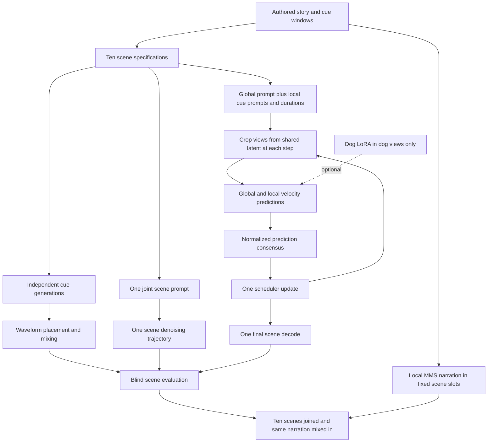

# Composition during generation: controlled ten-scene study

## Research question and current status

Can a shared denoising trajectory conditioned on several sound categories improve
event coverage, temporal placement, and perceptual coherence relative to generating
and mixing independent stems? Improvement is a hypothesis, not an implementation claim.

Implementation and local tests are available. **No new GPU results exist yet.**
The earlier successful 62-second story remains unchanged. Earlier temporal/regional
dog experiments failed to establish reliable event placement.

The new story is **200 seconds / ten 20-second scenes**, covering forest, rain,
trees, wind, footsteps, running, wood, door, dog, piano. These are ten operational
categories, not ten acoustically disjoint classes: forest/trees/wind and wood/door
overlap. Ten different subsets appear across the scenes. Do not call this ten
independent datasets or ten trained experts. Only dog has a trained adapter.

## Architecture



Cues and timings are **authored in `examples/composition_study.json`**, not extracted
by an LLM. This holds the plan constant so planner errors cannot confound the audio
comparison. Narration is synthesized locally and kept identical across methods.
The research comparison is on soundscapes **without narration**; narrated versions
demonstrate the application and may conceal missing effects.

## Four methods

| Method | Operation | Adapter |
|---|---|---|
| stems | Generate each cue separately for its requested duration, level/fade/place and add waveforms | None |
| joint | One prompt naming all scene categories, one generation/decode | None |
| window | Global background prediction plus predictions on local views of the SAME latent, fused at every step | None |
| window_lora | Same local-view consensus | Dog LoRA only on dog views |

The first three isolate generation/composition strategy with the same backbone.
The fourth is an adapter ablation. On scenes without dog, window and window_lora
should be identical; these are useful controls, not independent improvements.
All use the same checkpoint, 100 steps, CFG 7 and paired scene seeds 42/123/2026.
Stems use documented deterministic per-cue sub-seeds. Equal steps do **not** imply
equal computation: record calls, elapsed time and peak allocated VRAM.

## What changed from the unsuccessful regional pilot?

Earlier: each expert predicted the full padded clip, and a temporal mask retained
only a slice of that prediction. A bark placed elsewhere could be discarded.

Now: each cue receives the actual local slice of the shared noisy latent; its
position coordinates restart at zero and its text AND global duration conditions
describe the local window. An event view also names any full-scene background bed.
The global view names only full-scene background categories (or quiet room tone if
none), so it does not explicitly request a dog throughout the entire scene. The
joint-prompt baseline names all categories globally. This prompt decomposition is
part of the window method, not an isolated weight-only ablation.
No independently generated waveform is inserted into the joint methods.

For latent position tau and diffusion step t:

`v(tau) = [v_global(tau) + sum_i w_i(tau) P_i(v_i(R_i(z_t), c_i, d_i))] / [1 + sum_i w_i(tau)]`

R crops a local view; P scatters its prediction back. The configured local weight
is 4 with five-frame soft edges. CFG is linear and is applied after consensus;
the pinned pipeline then makes **one** scheduler step on the shared latent.
This model predicts **velocity**, not epsilon. Prediction blending is not physical
waveform addition and does not guarantee retention of overlapping sources.

This is an **experimental audio adaptation inspired by local-view diffusion
consensus**, not a claim to invent MultiDiffusion or a complete Mixture-of-LoRAs bank.
Local short crops may be out of the pretrained model's distribution. Transformer
attention, VAE receptive fields and competing prompts can still cause leakage,
missing events or artifacts. A larger weight could also harm coherence; the initial
study fixes it at 4, without selecting the best weight per evaluated sample.

References: [MultiDiffusion paper](https://arxiv.org/abs/2302.08113),
[Stable Audio Open authors' demo and architecture](https://stability-ai.github.io/stable-audio-open-demo/).
Stable Audio Open supports clips up to approximately 47 seconds. Consequently this
is one shared generation **per scene**, followed by story assembly. It is not one
200-second trajectory, and narration is still added afterward.

## Run now

Commit/push local changes as usual. On **gpu73**, CPU narration uses the existing
downloaded TTS model, no new downloads:

```bash
cd ~/C-MOLO-BGM
git pull --ff-only
conda activate cmolo-gpu
CUDA_VISIBLE_DEVICES="" python scripts/prepare_study_narration.py
```

On **master**, submit from the shared project directory. Do not export empty
CUDA_VISIBLE_DEVICES in this submission shell; Slurm supplies GPU visibility.

```bash
cd ~/C-MOLO-BGM
git pull --ff-only
mkdir -p logs
sbatch -p gpupart_v100 jobs/composition_study.sbatch \
  "$HOME/miniconda3/envs/cmolo-gpu/bin/python" \
  outputs/lora-pilot-29967/best-adapter.pt
```

This runs local-window tests first and a full-view identity check against the real
checkpoint. It then produces **120 scene outputs**: 10 scenes x 3 seeds x 4 methods.
Each completed output is recorded immediately. A failed job retains partial files
but is not resumable automatically; do not overwrite it. A new `--scenes`/`--seeds`
subset run can isolate a failure. Three hours is the allocation limit, not a measured
runtime estimate. No new training or checkpoints are required.

For an optional engineering-only run instead, append:
`--smoke --scenes 03_warning --seeds 42`. Never rate two-step smoke audio.

After successful GPU completion, replace JOB below with the job number. Run on gpu73:

```bash
conda activate cmolo-gpu
CUDA_VISIBLE_DEVICES="" python scripts/assemble_composition_story.py \
  --study outputs/composition-JOB --out outputs/composition-story-JOB
python scripts/summarize_composition_study.py --study outputs/composition-JOB
```

Story assembly defaults to seed 42, selected in advance. Use different output folders
and `--seed 123` or `--seed 2026` for the other replicas. Do not choose only the best.

## Analysis and listening protocol

Keep `blind-key.csv` hidden while listening to `listen/*.wav`. Letter assignments
change per scene/seed. The listening set matches RMS within each four-method group
then applies common peak headroom; this is **not LUFS matching**. Raw outputs and
their storage gain remain available. Check near-silent flags before interpreting
level-matched clips, which can amplify failures. No candidate selection is performed.

Fill `ratings.csv` with one listener per copy:

- `present`: 1 if the requested event occurrence can be heard, 0 if absent; blank unreviewed.
- `first_onset_s`, `last_offset_s`: observed boundaries within the 20-second scene.
  For repeated dog cues, attribute distinct occurrences to their respective windows;
  do not count one occurrence as satisfying both. Approximate listening annotations.
- `outside_window`: 1 if that event is audible outside its target window, otherwise 0.
- `fidelity_1to5`: 1 unrecognizable/poor to 5 convincing for present events.
- `cohesion_1to5`: 1 disconnected/clashing to 5 coherent scene; enter once per sample.
- `artifacts_1to5`: 1 severe artifacts to 5 clean; enter once per sample.
- `notes`: unwanted sounds, masking, unnatural timing, discontinuities.

Run the summary command again after review. It reports category presence, missing
events, onset error for detected events, leakage, ratings and measured compute.
Blank fields produce null, never a fabricated score. Always show detection coverage
beside timing error: a method that produces no dog must not win timing by omission.
Onset error does not imply dense temporal IoU; intermittent events need richer labels
for that metric. Scene ratings count once per audio, not once per cue.

For the presentation: use per-category coverage, per-method timing/leakage, coherence
and fidelity, and runtime/memory. Show all seeds, with seed/scene paired comparisons.
One listener is exploratory evidence. Add independent listeners if available and
report their number; do not treat three seeds as three people or claim significance
from this small correlated sample. Forest/trees/wind confusion must be discussed.

Do not compute FAD from this tiny unmatched story set or treat CLAP similarity as
proof of event timing. These need a separate validated evaluation setup.

### Optional automatic semantic analysis (no hand-entered timestamps needed)

An independent [LAION CLAP evaluator](https://huggingface.co/laion/clap-htsat-unfused)
can score each of the ten category descriptions against 5-second audio windows,
advanced every 2.5 seconds. This is a coarse semantic check, not a calibrated sound
detector. The checkpoint is pinned at download time. Its use here is additional
analysis; it does not train or change the generated samples.

On gpu73, while the generation job runs:

```bash
conda activate cmolo-gpu
CUDA_VISIBLE_DEVICES="" python scripts/download_clap.py
```

After generation, on gpu73 (CPU; leave its occupied GPUs alone):

```bash
CUDA_VISIBLE_DEVICES="" python scripts/score_composition_clap.py --study outputs/composition-JOB
```

Produces `clap-windows.csv` and `clap-analysis.json`: category similarity inside
requested windows and contrast against windows outside the requested regions.
Windows with at least 80% target coverage are inside, at most 20% are outside;
intermediate windows are excluded from the contrast. Continuous categories have
no off-target contrast (null). The thresholds describe temporal overlap, not a
classifier decision. Fixed text descriptions and windows are identical across methods.

CLAP can confuse forest/trees/wind, miss quiet overlapping sources, and prefer its
own learned vocabulary. It cannot certify naturalness, fidelity, absence of
artifacts, or exact onset timing. Use listening alongside it. This optional scorer
requires the remote transformers environment and has **not yet been exercised with
the downloaded CLAP checkpoint**. Report model revision and these limitations.

## Presentation deliverables after this run

1. Existing baseline story plus the four 200-second versions from fixed seed 42.
2. Architecture and formula above, distinguishing authored planning from synthesis.
3. Ten-scene/three-seed results table with perceptual and engineering measures.
4. Positive examples AND failures, including the earlier regional failure.
5. Conclusion based on evidence: whether joint generation helped coverage/coherence,
   whether local windows helped timing, and whether dog LoRA added value.

If local consensus fails, retain the result; the joint-prompt vs stems comparison
still answers the broader multi-category generation question. Do not rename a
stem-mixed output as latent composition or replace failed samples silently.
